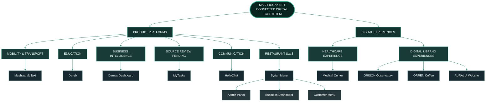
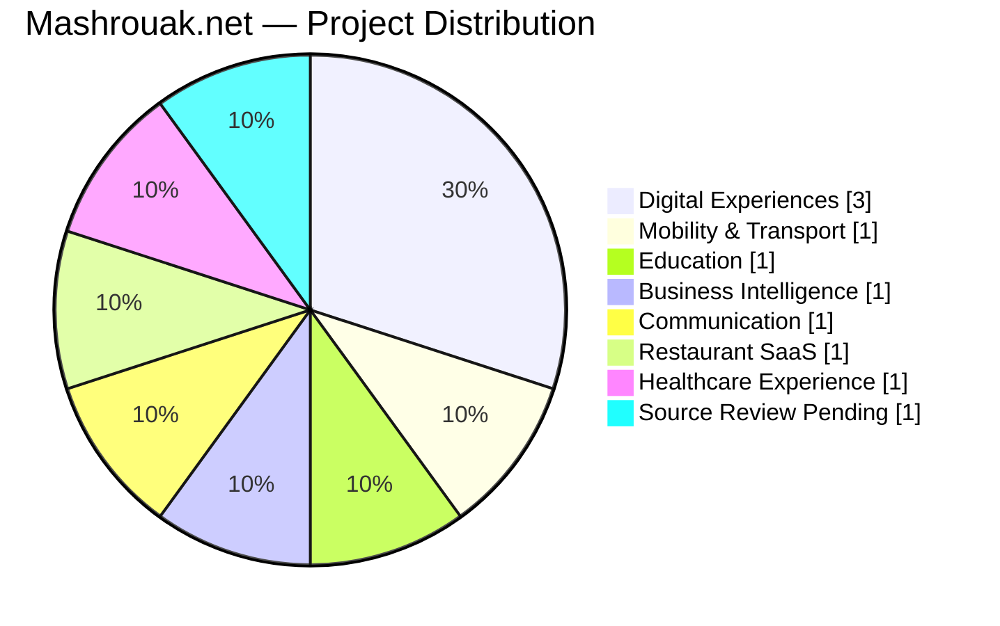
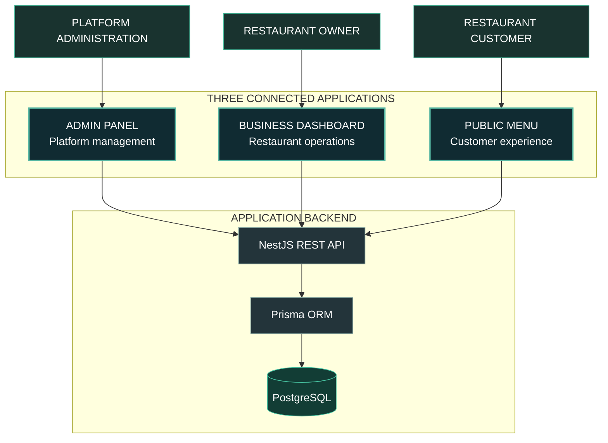
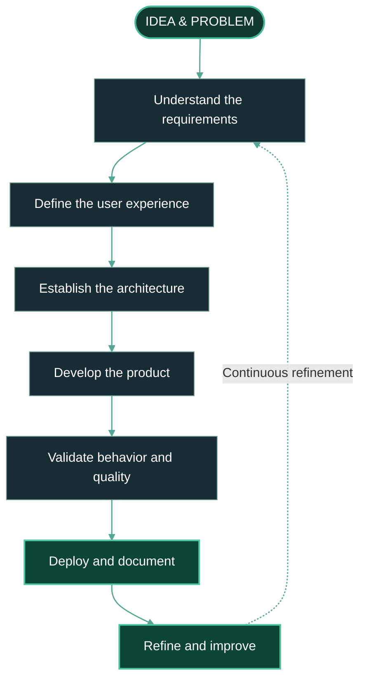

# MASHROUAK.NET

### ENGINEERING THE DIGITAL FUTURE.

**Ideas become products. Products become experiences.**

A software and technology initiative focused on building practical digital products, intelligent business platforms, modern web applications, and mobile experiences.

 

[ EXPLORE PROJECTS ]( #project-showcase ) &nbsp; · &nbsp; [ TECHNOLOGY ]( #technology-ecosystem ) &nbsp; · &nbsp; [ CONNECT ]( #connect-with-us )

 

`DIGITAL PRODUCTS` &nbsp; `SOFTWARE ENGINEERING` &nbsp; `CONNECTED EXPERIENCES`

---

## 01 — THE VISION

We believe exceptional software is built where thoughtful engineering meets meaningful experiences.

Mashrouak.net brings together a diverse portfolio of digital products, from mobile applications and business intelligence dashboards to SaaS platforms and immersive web experiences.

Each project represents a different approach to solving problems through technology, with an emphasis on usability, maintainability, thoughtful architecture, and purposeful design.

Our portfolio includes interconnected product concepts and independently developed applications. Each maintains its own technical architecture and deployment.

---

## 02 — THE DIGITAL ECOSYSTEM

A portfolio of products connected by one vision.

The following visualization represents the organization of our projects, their product categories, and the different digital experiences they deliver.

The three Syrian Menu interfaces represent one project with three separate deployment entry points. They are not counted as three projects.

### Portfolio distribution

Our portfolio currently contains ten listed projects, organized into mutually exclusive categories.

| Category | Projects | Count |
|:---|:---|---:|
| Digital Experiences | ORISON, ORREN, AURALIA | 3 |
| Mobility & Transport | Mashwarak Taxi | 1 |
| Education | Dareb | 1 |
| Business Intelligence | Damas Dashboard | 1 |
| Communication | HelloChat | 1 |
| Restaurant SaaS | Syrian Menu | 1 |
| Healthcare Experience | Medical Center | 1 |
| Source Review Pending | MyTasks | 1 |
| **Total** | **All listed projects** | **10** |

*Classification note: MyTasks is included in the supplied project list, but its repository could not be retrieved for documentation review. It is therefore kept in a separate verification category rather than assigned an unverified technical classification.*

---

## 03 — FEATURED PRODUCT

# SYRIAN MENU

### A complete digital menu ecosystem for restaurants.

FEATURED SaaS PRODUCT · RESTAURANT TECHNOLOGY · MULTI-APPLICATION ARCHITECTURE

Syrian Menu is a digital restaurant menu management platform designed to help businesses create, customize, publish, and maintain their menus through a centralized system.

Restaurants manage their content through an owner dashboard, while customers access published menus through QR codes.

The platform combines three independent React applications, a NestJS REST API, and PostgreSQL.

<strong>EXPLORE THE PRODUCT ARCHITECTURE</strong>

### Three interfaces. One integrated product.

<strong>01 — ADMIN PANEL</strong>

The platform administration interface.

Designed for platform-level management, including:

- Restaurant creation and administration.
- Owner account management.
- Restaurant access and publication controls.
- Trial management.
- Administrative activity monitoring.
- Customer support and restaurant communications.

<badge-placeholder></badge-placeholder>

**LIVE APPLICATION**

[Open Admin Panel →](https://syrian-menu-admin.pages.dev)

<strong>02 — BUSINESS DASHBOARD</strong>

The restaurant owner's management environment.

Designed to provide control over the restaurant's digital presence.

- Create and manage menu categories.
- Add, edit, reorder, and remove dishes.
- Manage prices, availability, and dietary information.
- Customize restaurant identity and visual presentation.
- Publish menus and generate QR codes.
- Preview menu designs before publishing.
- Manage restaurant support conversations.

**LIVE APPLICATION**

[Open Business Dashboard →](https://syrian-menu-dashboard.pages.dev)

<strong>03 — CUSTOMER MENU</strong>

The public-facing restaurant experience.

Customers can:

- Browse published restaurant menus.
- Navigate menu categories.
- Search dishes.
- Open individual dish details.
- Switch between Arabic and English.
- Experience responsive layouts and RTL/LTR interfaces.
- Access restaurant menus through their QR destinations.

No customer account is required to browse a public menu.

**LIVE APPLICATION**

[Open Customer Menu →](https://syrian-menu-public.pages.dev)

### Technical foundation

| Layer | Verified technologies |
|---|---|
| Frontend | React 19, TypeScript 6 |
| Routing | React Router 7 |
| Build system | Vite 8 |
| Styling | Tailwind CSS 4 |
| Backend | NestJS 11 |
| Database | PostgreSQL |
| ORM | Prisma 6 |
| Validation | Zod |
| Data fetching | TanStack Query |
| Testing | Vitest, Playwright |

**Architecture highlights**

- Three separately built frontend applications.
- Centralized REST API.
- Shared validation contracts and UI packages.
- Database-backed restaurant and account management.
- Server-side authorization and restaurant access checks.
- Image storage with local or S3-compatible support.
- Bilingual menu content and interface support.

The current implementation focuses on menu management and presentation. Checkout, payment processing, and order fulfillment are outside its implemented workflow.

**Source repository**

[Syrian Menu — GitHub Repository](https://github.com/SaadSinan-dev/Syrian-Menu-Website)

---

## 04 — PROJECT SHOWCASE

# BUILT WITH PURPOSE.

Explore the complete collection of Mashrouak.net projects.

Each project is presented with its actual purpose, verified implementation technologies, and available deployment.

---

### 01 / MASHWARAK TAXI

MOBILITY · TRANSPORTATION · MOBILE APPLICATION

**Connecting passengers and drivers through a digital ride-hailing experience.**

Mashwarak is an Arabic-first ride-hailing platform designed for the Syrian market.

Its Flutter application brings together two experiences in one application: the passenger interface and the driver interface.

The backend uses Supabase and PostgreSQL to manage important ride operations, including trip transitions, fare calculation, driver eligibility, and financial records.

**Implemented capabilities**

- Passenger and driver application experiences.
- Ride requests and trip tracking.
- Driver availability and nearby requests.
- Server-side fare calculation.
- Trip lifecycle management.
- Driver eligibility and verification rules.
- Earnings and wallet functionality.
- Arabic and English localization.

**Verified technology stack**

`Flutter` `Dart` `BLoC/Cubit` `Supabase` `PostgreSQL` `PostGIS` `Firebase Cloud Messaging`

**Explore**

- [SOURCE CODE — GitHub](https://github.com/SaadSinan-dev/Mashwarak-Taxi)
- [LIVE DEMO — Mashwarak Taxi](https://mashwarak.netlify.app/)

---

### 02 / DAREB — EDUCATIONAL MOBILE APP

EDTECH · MOBILE APPLICATION · EDUCATION

**A digital learning experience built around students and educational content.**

Dareb is an Arabic-first educational mobile application that allows students to discover subjects, access lessons, complete assessments, and manage their learning profiles.

The application integrates with a REST API for authentication, educational content, and account operations.

**Implemented capabilities**

- Phone-based authentication and profile management.
- Subject and course discovery.
- Chapters and lesson navigation.
- Assessment submission and result review.
- Learning activity history.
- Educational gallery.
- Student achievements and account information.
- Arabic and English interfaces.
- RTL/LTR layouts.

**Verified technology stack**

`Flutter` `Dart` `BLoC/Cubit` `Dio` `GoRouter` `GetIt` `Flutter Secure Storage` `SharedPreferences`

**Explore**

- [SOURCE CODE — GitHub](https://github.com/SaadSinan-dev/Dareb-Educational-Mobile-App)
- [LIVE DEMO — Dareb](https://darb-mobile.netlify.app/)

---

### 03 / DAMAS DASHBOARD

BUSINESS INTELLIGENCE · ANALYTICS · DASHBOARD

**Transforming business information into a clear visual experience.**

Damas Dashboard is a bilingual business intelligence and administration dashboard built with Flutter.

It presents commercial performance information through a structured interface, with particular attention to data visualization, localization, and maintainable application architecture.

**Implemented capabilities**

- KPI cards and performance indicators.
- Period-over-period comparisons.
- Revenue time-series visualization.
- Recent activity feed.
- Searchable report library.
- Report filtering and sorting.
- English and Arabic localization.
- RTL layout support.
- Persistent user preferences.
- Light and dark themes.

**Data implementation note**

The repository uses a bundled JSON data source shaped like an API response. It is not currently connected to a live business backend.

**Verified technology stack**

`Flutter` `Dart` `BLoC/Cubit` `GoRouter` `GetIt` `fl_chart` `SharedPreferences` `intl`

**Explore**

- [SOURCE CODE — GitHub](https://github.com/SaadSinan-dev/DamasDashboard)
- [LIVE DEMO — Damas Dashboard](https://damas-dashboard.netlify.app/)

---

### 04 / MYTASKS

PROJECT LISTING · SOURCE REVIEW PENDING

**A listed project within the Mashrouak.net portfolio.**

MyTasks is included in the supplied project collection.

The supplied source repository could not be retrieved during this documentation review. Consequently, its implementation details, features, architecture, and technology stack are intentionally not asserted here.

**Explore**

- [SOURCE CODE — GitHub](https://github.com/SaadSinan-dev/MyTasks)
- [LIVE DEMO — MyTasks](https://mydaily-tasks.netlify.app/)

---

### 05 / HELLOCHAT

COMMUNICATION · MESSAGING · MOBILE APPLICATION

**A messaging interface built around clean architecture and persistent local data.**

HelloChat is a Flutter messaging client designed to demonstrate a structured messaging experience.

The application uses a local reactive and persistent data source rather than a connected chat server. Its data architecture is deliberately separated so that a remote implementation can be introduced at the data layer.

**Implemented capabilities**

- Conversation management.
- Pinned and muted conversations.
- Unread message indicators.
- Message threads and quoted replies.
- Message delivery and read receipts.
- Conversation search and filtering.
- Contact management.
- Call history.
- Persistent local messages.
- Arabic and English with RTL support.
- Designed light and dark themes.

**Verified technology stack**

`Flutter` `Dart` `BLoC/Cubit` `GetIt` `GoRouter` `SharedPreferences` `Equatable` `Flutter Localizations`

**Architecture note**

The current project does not include a remote chat server or real-time messaging backend.

**Explore**

- [SOURCE CODE — GitHub](https://github.com/SaadSinan-dev/HelloChat)
- [LIVE DEMO — HelloChat](https://hello-chat-message.netlify.app/)

---

### 06 / MEDICAL CENTER WEBSITE

HEALTHCARE EXPERIENCE · WEB APPLICATION · UX DESIGN

**A structured digital experience for discovering medical services.**

Damascus Medical Center is a medical-center website concept featuring searchable care directories, clinician profiles, and a guided appointment demonstration.

The project focuses on clear navigation, accessible interaction patterns, responsive composition, and validated form experiences.

**Implemented capabilities**

- Searchable medical specialties.
- Specialty filtering and detail pages.
- Clinician directory.
- Clinician profile pages.
- Four-step appointment demonstration.
- Form validation.
- Appointment review and editing.
- Responsive navigation.
- FAQ and informational pages.
- English interface with bilingual brand identity.

**Important scope note**

The medical center is a fictional portfolio brand. Clinicians, premises, and availability are sample content. Appointment and contact interactions demonstrate client-side behavior and do not transmit actual bookings.

**Verified technology stack**

`React 19` `TypeScript` `React Router 7` `Vite 8` `Tailwind CSS 4` `Zod 4` `Vitest` `Playwright`

**Explore**

- [SOURCE CODE — GitHub](https://github.com/SaadSinan-dev/Medical-Center-Website)
- [LIVE DEMO — Medical Center](https://damascus-medical-center.netlify.app/)

---

### 07 / ORISON — OBSERVATORY EXPERIENCE

INTERACTIVE WEB · 3D GRAPHICS · DIGITAL EXPERIENCE

**An immersive exploration of space, visual storytelling, and interactive technology.**

Orison Observatory is a cinematic, scroll-driven website concept built around a layered 3D Earth and orbital visual experience.

Its written content and navigation remain usable independently of the 3D renderer.

**Implemented capabilities**

- Six accessible content chapters.
- Scroll-driven visual storytelling.
- Layered 3D Earth rendering.
- Orbital structures and animated visual elements.
- Adaptive rendering quality.
- Lazy-loaded 3D scenes.
- Motion controls and reduced-motion support.
- WebGL failure fallbacks.
- Responsive navigation.
- Local demonstration terminal.

**Technical distinction**

The terminal uses locally prepared topic-based answers. It is not connected to an external AI model or live intelligence service.

The Earth imagery uses historical NASA visual composites rather than live satellite observation.

**Verified technology stack**

`React` `TypeScript` `Vite` `React Three Fiber` `Three.js`

**Explore**

- [SOURCE CODE — GitHub](https://github.com/SaadSinan-dev/ORISON-website)
- [LIVE DEMO — ORISON](https://orinos.vercel.app/)

---

### 08 / ORREN — SPECIALTY COFFEE

DIGITAL COMMERCE · E-COMMERCE EXPERIENCE · 3D PRODUCT DESIGN

**A premium specialty coffee storefront with interactive product experiences.**

ORREN Coffee is a multi-route storefront concept designed to model the experience of a modern specialty coffee brand.

It combines product discovery, editorial content, client-side commerce interactions, and optional 3D product visualization.

**Implemented capabilities**

- Product catalog and discovery.
- Search, filtering, and sorting.
- Product detail pages.
- Coffee origin and editorial pages.
- Multiple bag-size variants.
- Persistent shopping cart.
- Cart validation and trusted catalog pricing.
- Demonstration checkout.
- Interactive 3D coffee pouch.
- Scroll-driven coffee journey.
- Responsive and reduced-motion experiences.

**Technical distinction**

This is a front-end commerce demonstration. It does not currently include a backend, payment provider, order API, user accounts, or order database.

**Verified technology stack**

`React 19` `TypeScript` `React Router 7` `Vite` `Tailwind CSS` `GSAP` `ScrollTrigger` `Three.js` `React Three Fiber` `Drei`

**Explore**

- [SOURCE CODE — GitHub](https://github.com/SaadSinan-dev/ORREN-website)
- [LIVE DEMO — ORREN](https://orren-nine.vercel.app/)

---

### 09 / AURALIA — AURELIA PARTNERS

BRAND EXPERIENCE · PROFESSIONAL SERVICES · WEB DESIGN

**A cinematic digital identity for a modern professional-services concept.**

AURALIA is a fictional legal-services website concept, identified in its repository as Aurelia Partners.

The experience combines editorial presentation, responsive layouts, refined typography, visual depth, and scroll-driven animation.

**Implemented capabilities**

- Editorial single-page composition.
- Professional service and practice-area presentation.
- Scroll-driven section transitions.
- Interactive visual panels.
- Abstract visual sculpture.
- Animated SVG network visualization.
- Responsive navigation.
- Pointer-based visual effects.
- Reduced-motion support.
- Dedicated desktop and mobile motion behavior.

**Important scope note**

The legal practice is fictional. Its illustrative content and demonstration statistics do not represent real legal services or business results. The project has no backend, database, authentication, or client portal.

**Verified technology stack**

`React 18` `JavaScript` `Vite 5` `Tailwind CSS 3` `GSAP` `ScrollTrigger` `Lenis` `SVG` `CSS 3D`

**Explore**

- [SOURCE CODE — GitHub](https://github.com/SaadSinan-dev/AURALIA-website)
- [LIVE DEMO — AURALIA](https://aurelia-nine-amber.vercel.app/)

---

## 05 — WHAT WE BUILD

### Digital solutions across different domains.

Our project portfolio explores several areas of software development.

| DOMAIN | FOCUS |
|---|---|
| **Mobile Applications** | Cross-platform experiences, navigation, state management, and mobile-first product interfaces. |
| **SaaS Platforms** | Multi-interface applications, account management, administrative workflows, and centralized services. |
| **Business Intelligence** | KPI presentation, reports, visual analytics, and business information interfaces. |
| **Educational Technology** | Learning experiences, course discovery, lessons, assessments, and student-oriented interfaces. |
| **Communication Products** | Messaging interfaces, conversation management, and persistent application state. |
| **Digital Commerce** | Product discovery, catalog experiences, shopping interactions, and product visualization. |
| **Professional Websites** | Brand presentation, structured content, responsive experiences, and conversion-oriented navigation. |
| **Interactive 3D Experiences** | Web-based visual environments, spatial storytelling, and progressive graphics enhancement. |

---

## 06 — TECHNOLOGY ECOSYSTEM

### Engineering with the right tools for each product.

Our technology choices are determined by the requirements and architecture of each individual project.

The following map summarizes the principal technology families verified in the available repositories.

```mermaid
flowchart TB

    subgraph MOBILE["MOBILE APPLICATION ENGINEERING"]
        direction LR

        TAXI["Mashwarak Taxi"]
        DAREB["Dareb"]
        DAMAS["Damas Dashboard"]
        HELLO["HelloChat"]

        FLUTTER["Flutter<br/>Dart"]
        STATE["BLoC / Cubit"]
        NAV["GoRouter / GetIt"]

        TAXI --> FLUTTER
        DAREB --> FLUTTER
        DAMAS --> FLUTTER
        HELLO --> FLUTTER

        FLUTTER --> STATE
        FLUTTER --> NAV
    end

    subgraph WEB["REACT WEB APPLICATIONS"]
        direction LR

        SYRIAN["Syrian Menu"]
        MEDICAL["Medical Center"]
        ORISON["ORISON"]
        ORREN["ORREN"]

        REACTTS["React<br/>TypeScript<br/>Vite"]

        SYRIAN --> REACTTS
        MEDICAL --> REACTTS
        ORISON --> REACTTS
        ORREN --> REACTTS

        AURALIA["AURALIA"] --> REACTJS["React<br/>JavaScript<br/>Vite"]
    end

    subgraph BACKEND["BACKEND & DATA TECHNOLOGIES"]
        direction LR

        SYRIAN --> NEST["NestJS<br/>Prisma<br/>PostgreSQL"]

        TAXI --> SUPABASE["Supabase<br/>PostgreSQL<br/>PostGIS"]
    end

    subgraph VISUALS["3D & MOTION TECHNOLOGIES"]
        direction LR

        ORISON --> THREE["Three.js<br/>React Three Fiber"]
        ORREN --> THREE

        ORREN --> GSAP["GSAP<br/>ScrollTrigger"]
        AURALIA --> GSAP

        AURALIA --> LENIS["Lenis"]
    end

    classDef app fill:#172C32,stroke:#62A999,color:#FFFFFF;
    classDef framework fill:#123B32,stroke:#3DBD9A,color:#FFFFFF,stroke-width:2px;
    classDef tech fill:#24383B,stroke:#85AAA0,color:#FFFFFF;
    classDef backend fill:#173B35,stroke:#45B99A,color:#FFFFFF;

    class TAXI,DAREB,DAMAS,HELLO,SYRIAN,MEDICAL,ORISON,ORREN,AURALIA app;
    class FLUTTER,REACTTS,REACTJS framework;
    class STATE,NAV,THREE,GSAP,LENIS tech;
    class NEST,SUPABASE backend;
```

*The connections represent technology usage in individual repositories. They do not imply a shared backend, common deployment, or a single universal application architecture.*

### Verified technology inventory

**Mobile development**

- Flutter
- Dart
- BLoC / Cubit
- GoRouter
- GetIt
- Dio
- Flutter Secure Storage
- SharedPreferences
- Firebase Cloud Messaging

**Frontend development**

- React
- TypeScript
- JavaScript
- React Router
- Vite
- Tailwind CSS
- CSS
- SVG

**Backend and data**

- NestJS
- PostgreSQL
- Prisma
- Supabase
- PostGIS
- REST APIs
- Zod

**Visualization and interaction**

- Three.js
- React Three Fiber
- React Three Fiber Drei
- GSAP
- ScrollTrigger
- Lenis
- fl_chart

**Testing and quality**

- Vitest
- Playwright
- React Testing Library
- flutter_test
- bloc_test
- Oxlint
- TypeScript compiler

*This inventory reflects the inspected project manifests and documentation. Technologies are not attributed to projects whose repositories could not be verified.*

---

## 07 — DEVELOPMENT PHILOSOPHY

### Engineering is more than writing code.

We believe successful digital products require a balance between technical quality, usability, and a clear understanding of the problem being solved.

Our development approach is guided by four principles.

#### 01 — PURPOSE BEFORE COMPLEXITY

Every product should have a clear reason to exist.

We favor useful functionality, understandable workflows, and solutions that address real user needs instead of unnecessary technical complexity.

#### 02 — ARCHITECTURE THAT MAKES SENSE

Good architecture should make applications easier to understand, maintain, and extend.

We value separation of responsibilities, clear data boundaries, reusable components, and predictable application behavior.

#### 03 — EXPERIENCE IS PART OF ENGINEERING

Performance, accessibility, responsive design, localization, and visual consistency are not afterthoughts.

They are part of the product itself.

#### 04 — HONEST, PRACTICAL SOFTWARE

A prototype should be identified as a prototype. A local demonstration should not be presented as a production service.

We believe clear technical boundaries and transparent documentation are essential to building trustworthy digital products.

---

## 08 — OUR APPROACH TO DIGITAL PRODUCTS

A simplified view of how we think about product development.

---

## 09 — EXPLORE THE PORTFOLIO

All ten projects and their corresponding source repositories and deployment destinations are listed below.

| PROJECT | SOURCE CODE | DEPLOYMENT |
|---|---|---|
| Mashwarak Taxi | [GitHub](https://github.com/SaadSinan-dev/Mashwarak-Taxi) | [Live](https://mashwarak.netlify.app/) |
| Dareb | [GitHub](https://github.com/SaadSinan-dev/Dareb-Educational-Mobile-App) | [Live](https://darb-mobile.netlify.app/) |
| Damas Dashboard | [GitHub](https://github.com/SaadSinan-dev/DamasDashboard) | [Live](https://damas-dashboard.netlify.app/) |
| MyTasks | [GitHub](https://github.com/SaadSinan-dev/MyTasks) | [Live](https://mydaily-tasks.netlify.app/) |
| HelloChat | [GitHub](https://github.com/SaadSinan-dev/HelloChat) | [Live](https://hello-chat-message.netlify.app/) |
| Syrian Menu | [GitHub](https://github.com/SaadSinan-dev/Syrian-Menu-Website) | [Admin](https://syrian-menu-admin.pages.dev) · [Dashboard](https://syrian-menu-dashboard.pages.dev) · [Menu](https://syrian-menu-public.pages.dev) |
| Medical Center | [GitHub](https://github.com/SaadSinan-dev/Medical-Center-Website) | [Live](https://damascus-medical-center.netlify.app/) |
| ORISON | [GitHub](https://github.com/SaadSinan-dev/ORISON-website) | [Live](https://orinos.vercel.app/) |
| ORREN | [GitHub](https://github.com/SaadSinan-dev/ORREN-website) | [Live](https://orren-nine.vercel.app/) |
| AURALIA | [GitHub](https://github.com/SaadSinan-dev/AURALIA-website) | [Live](https://aurelia-nine-amber.vercel.app/) |

**Portfolio totals:** 10 project repositories supplied · 12 deployment URLs supplied.

---

## 10 — CONNECT WITH US

# LET'S BUILD SOMETHING MEANINGFUL.

Technology creates possibilities.

Thoughtful engineering turns those possibilities into products people can use.

We are continuously exploring ideas, developing digital experiences, and expanding the Mashrouak.net portfolio.

 

**MASHROUAK.NET**

[OFFICIAL WEBSITE](https://mashrouak.net)

[EXPLORE OUR GITHUB ORGANIZATION](https://github.com/Mashrouak-net)

 

`BUILD WITH PURPOSE.`

`ENGINEER WITH PRECISION.`

`CREATE WITH VISION.`

 

---

© Mashrouak.net · All rights reserved.

Digital Products · Software Engineering · Connected Experiences

